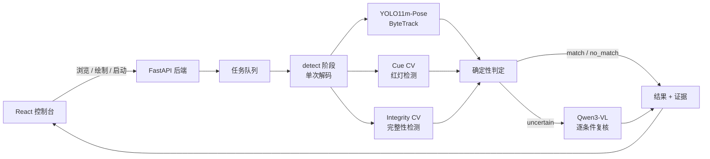

<div align="center">

# UltraConsole

### AI 监控视频事件分析控制台

**YOLO 姿态跟踪 · 确定性事件规则 · Qwen3-VL 语义复核 · 可回放证据链**


</div>

<p align="center">
  
</p>

UltraConsole 面向**长视频监控场景**：先由 YOLO11m-Pose + ByteTrack 找到“人/车/物”的关键时刻，再由传统 CV 与 Qwen3-VL 视觉语言模型判断**事件是否真的发生**，最后输出带证据帧、可回放、可人工复核的结果。

它不是“把整段视频丢给大模型”的 Demo，而是一条可落到生产工作流的分析流水线：**信号触发、确定性优先、模型复核、证据留痕**。

> **部署与启动**：请阅读 [部署指南](deploy.md)。README 只介绍项目能力与技术架构。

---

## 为什么是 UltraConsole

监控视频分析最常见的两个问题：

1. **逐人逐帧分析成本太高**：一条 24 小时录像可能有上千人通过，逐候选调用大模型既慢又贵；
2. **纯大模型判断不可靠**：模型容易复述规则、忽略画面细节，且结论难以复核。

UltraConsole 的做法是：

- **只分析“值得分析”的时刻**：支持信号区亮起触发、计数线/计数区触发、完整性变化触发；
- **确定性规则先判**：红灯状态、跨线方向、退回、轨迹连续性由 CV 直接计算；
- **VLM 只处理不确定项**：模型逐条件输出证据时间，代码按合取规则裁决；
- **每条结论都有证据**：保存触发窗口、采样帧、判断原因，支持回放与人工复核。

---

## 核心能力

| 能力 | 说明 |
|---|---|
| **信号触发事件** | 红灯/信号区亮起才分析；同一信号 3 秒内合并为一次 episode，不按通过人数放大成本 |
| **通道配对** | 入口计数线 + 可选计数区 + 信号区按编号一一配对，支持“进入后 5 秒内是否退回”判定 |
| **确定性优先** | 红灯状态、跨线方向、退回、轨迹连续性由 CV 计算；确定时直接出结果，不调用 VLM |
| **VLM 逐条件复核** | Qwen3-VL 对每个条件输出 `yes / no / unknown` 与证据时间，代码按合取真值表裁决 |
| **证据链** | 触发窗口、sample manifest、证据帧、判定原因、质量警告全部留痕，可回放定位 |
| **长视频吞吐** | tracking + cues + integrity 合并为单次解码；证据预览默认 lazy，按需生成 |
| **服务器侧视频** | 从服务器目录浏览/导入，同盘硬链接复用，不复制、不上传；支持文件夹批量 |
| **规则与模型可配** | 规则类别、触发类型、条件、窗口、阈值、2B/4B 模型、poseFps 等均可配置 |
| **可观测** | 任务队列、阶段进度、逐条结果、质量警告、运行日志与 CSV 导出 |

---

## 工作流

```text
选择服务器视频
      │
      ▼
绘制计数线 / 计数区 / 信号区 / 完整性区
      │
      ▼
定义事件规则并绑定区域
      │
      ▼
开始分析 ──► tracking + cues + integrity（单次解码）
      │
      ▼
确定性判定 ──► 不确定项 ──► Qwen3-VL 逐条件复核
      │
      ▼
结果 + 证据帧 + 回放 / 人工复核
```

### 两种分析模式

| 模式 | 回答的问题 | 技术路径 |
|---|---|---|
| **A · 经典 CV 检测/计数** | 画面里有什么、跨了几次线、进了几次区 | YOLO11-Pose + ByteTrack + 计数线/区 |
| **B · VLM 语义事件分析** | 这条告警到底成不成立、证据在哪一帧 | 确定性信号 + Qwen3-VL 逐条件判定 |

两者可以独立使用，也可以先用模式 A 画好线/区，再用模式 B 做事件核验。

---

## 系统架构



关键设计：

- **detect 单次解码**：pose、cue、integrity 共享同一条解码流，各自按采样率消费；
- **确定性短路**：能用规则判定的不走模型，降低成本和不确定性；
- **lazy 证据**：确定性结果只写 manifest，预览在首次查看时生成；
- **可恢复**：观测缓存、任务队列、阶段状态落盘，支持中断后继续/重跑。

---

## 技术栈

| 层 | 技术 |
|---|---|
| 前端 | React 19、TypeScript、Vite、Zustand、Canvas 2D |
| 后端 | FastAPI、Pydantic、Uvicorn、Python 3.10 |
| CV / 跟踪 | Ultralytics YOLO11m-Pose、ByteTrack、OpenCV、PyAV |
| VLM | Qwen3-VL-2B / 4B、Transformers、PyTorch、CUDA |
| 数据 | SQLite（observations）、JSONL（candidates/results）、gzip 缓存 |
| 部署 | Conda、Node.js、NVIDIA 驱动、WSL2 / Linux |
| 质量 | pytest、ruff、Vitest、ESLint、TypeScript build |

---

## 性能

在一段真实 30 分钟、1080p、`poseFps=5`、batch=16 + pipeline 的监控录像上实测（RTX 3080 Laptop，具体数字随硬件/视频变化）：

| 指标 | 结果 |
|---|---:|
| 完整 `detect`（tracking + 1 信号区 + 3 完整性区） | **179.7s** |
| tracking 阶段 | **89.3s** |
| 5 分钟任务、165 条确定性结果 understanding | **0.41s**（lazy 预览，0 张预览图） |
| 同 run 全缓存重放 | **1.5s** |

优化细节与后续路线见 [optimize.md](optimize.md)；架构与调试说明见 [dev-guide.md](dev-guide.md)。

---

## 快速开始

> **完整部署、启动/停止、手动步骤、常见问题与运行配置统一见 [部署指南](deploy.md)。**

部署完成后打开 `http://localhost:5100`，选择服务器视频，绘制区域并开始分析。

使用说明：

- [使用手册](docs/USAGE.md)：控制台、规则、VLM 分析、结果复核、记录管理
- [部署指南](deploy.md)：环境要求、一键部署、手动部署、日常启停、FAQ、运行配置

---

## 项目结构

```text
UltraConsole-VLM/
├── backend/                 FastAPI 服务、任务队列、视频/记录接口
├── frontend/                React 控制台、Canvas 绘制、结果复核
├── Rules/                   跟踪 / 信号 / 完整性 / 判定 / VLM 分析流水线
│   ├── src/ultra_rules/
│   └── tests/
├── models/                  Qwen3-VL 权重目录
├── docs/                    使用手册、设计文档
├── deploy.sh                一键部署脚本
├── start.sh / stop.sh       日常启停
├── dev-guide.md             架构、设计契约、代码地图与开发约定
├── optimize.md              性能优化路线与进度
└── CHANGELOG.md             历史开发记录
```

---

## 文档导航

| 文档 | 内容 |
|---|---|
| [部署指南](deploy.md) | 环境准备、一键/手动部署、启停、FAQ、运行配置 |
| [使用手册](docs/USAGE.md) | 界面、两种分析模式、事件规则、VLM 分析、结果复核 |
| [dev-guide.md](dev-guide.md) | 系统架构、设计契约、代码地图、开发与测试约定 |
| [optimize.md](optimize.md) | P0–P6 性能路线、红线、实测基线与进度 |
| [CHANGELOG.md](CHANGELOG.md) | 历史开发记录与阶段变更 |
| [信号触发规则设计](docs/signal-triggered-rules-plan.md) | 强行通过/信号 episode/通道配对的设计说明 |

---

## 开发与测试

```bash
# Python 测试
PYTHONPATH=backend:Rules/src python -m pytest Rules/tests backend/tests

# Python 静态检查
python -m ruff check Rules/src Rules/tests backend/app backend/tests

# 前端
cd frontend
npm test -- --run
npm run lint
npm run build
```

开发环境与代码结构详见 [dev-guide.md](dev-guide.md)。

---

## 贡献

欢迎提交 Issue / PR。涉及判定语义的改动请先阅读 [optimize.md](optimize.md) 中的“红线”和 [dev-guide.md](dev-guide.md) 的判定章节，并补充等价性回归测试。

---

## License

[MIT](LICENSE)
